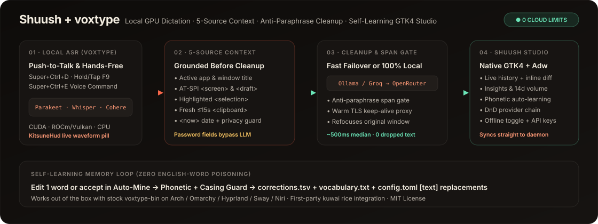
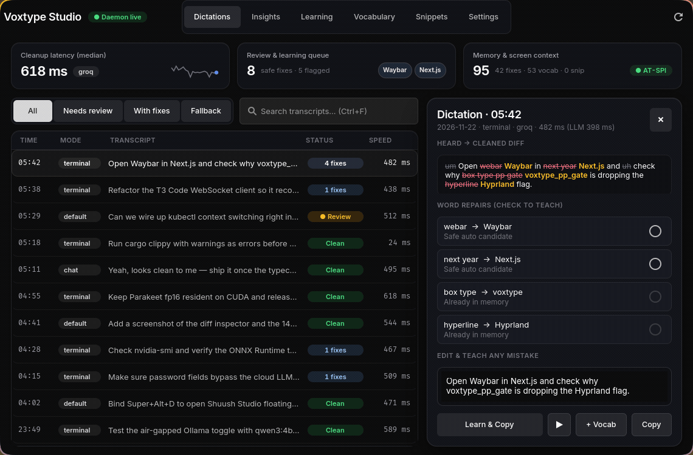
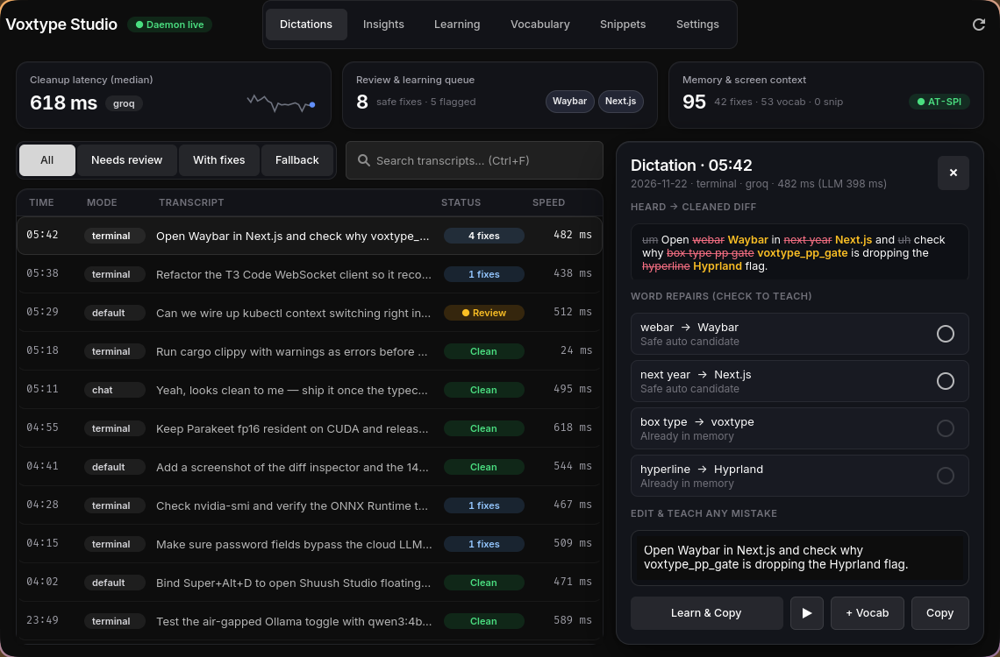
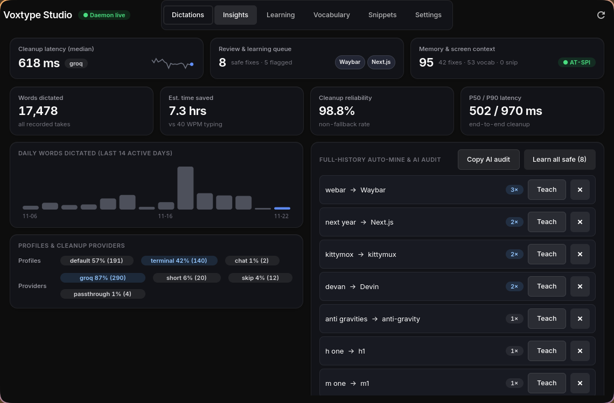
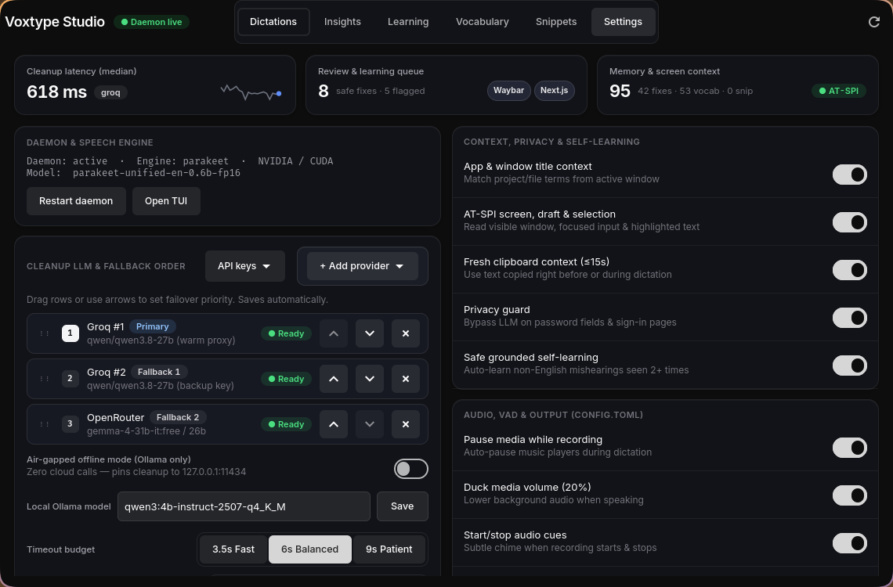

<p align="center">
  
</p>

<h1 align="center">Shuush</h1>

<p align="center">
  <strong>The open-source Superwhisper &amp; Wispr Flow experience for Linux &amp; Wayland — built cleanly on top of <a href="https://voxtype.io">voxtype</a>.</strong>
</p>

<p align="center">
  <a href="LICENSE"></a>
  
  
  
</p>

<p align="center">
  
</p>

> **Powered by [`peteonrails/voxtype`](https://github.com/peteonrails/voxtype) (MIT, Peter Jackson).**
> Shuush does **not** fork or replace your `voxtype` binary — it drops cleanly on top of stock `voxtype-bin` from Arch AUR or Omarchy repos with one command.

---

## Real-World Daily-Driver Numbers

Measured across **333 real coding & chat dictations** on a daily-driver Linux laptop (**Intel i5-13450HX · NVIDIA RTX 4050 Laptop 6 GB VRAM · 23 GiB RAM · Arch + Hyprland + `kuwai`**):

| Metric | Measured Result |
|---|---|
| **Total words dictated** | **19,498 words** (~**8.1 hrs saved** vs 40 WPM typing) |
| **Cleanup reliability** | **98.8%** non-fallback rate (zero dropped text on fallback) |
| **End-to-end cleanup latency** | **516 ms P50** · **1,060 ms P90** (warm TLS proxy + Groq; **24 ms** when already clean) |
| **ASR engine & VRAM** | `parakeet-unified-en-0.6b-fp16` on CUDA (~**2.3 GB VRAM** resident, fits comfortably on 6 GB laptop GPUs) |
| **Voice Command & Privacy** | Highlighted `<selection>` edit in place + AT-SPI password-field bypass |

---

## Why Shuush + `voxtype`

| Feature | Wispr Flow | Superwhisper *(Omarchy default)* | **Shuush + `voxtype`** |
|---|---|---|---|
| **Price & word limits** | $15/mo, cloud | 10k free words/mo (cloud tier) | **Free, MIT open-source, unlimited** |
| **Platform** | macOS / Windows | macOS / Omarchy | **Native Wayland (Hyprland · Niri · Sway · Arch · Omarchy)** |
| **Speech engine** | Cloud | Cloud or local | **Local Parakeet / Whisper / Cohere GGUF via `voxtype`** |
| **GPU support** | Cloud | Apple Silicon / Cloud | **NVIDIA CUDA · AMD ROCm/Vulkan · Intel Vulkan · CPU** |
| **Context awareness** | App + screen | App + selection + clipboard + date | **App + AT-SPI `<screen>` + focused `<draft>` + `<selection>` + fresh `≤15s` `<clipboard>` + `<now>`** |
| **Privacy guard** | Cloud telemetry | Cloud option | **AT-SPI password-field bypass + 1-click Air-Gapped Ollama mode** |
| **Anti-hallucination** | Closed prompt | Closed prompt | **Deterministic anti-paraphrase span gate (`voxtype_pp_gate.py`)** |
| **Self-learning** | Proprietary | Manual + AI audit | **Phonetic grounded auto-learning + reject blocklist + daemon `[text]` sync** |
| **Control Center** | Electron | Native macOS | **Native GTK4 + Libadwaita Studio (live updates, diff inspector, insights, API keys, DnD failover)** |

---

## Shuush Studio Showcase

### 1. Live Dictations & Inline Diff Inspector
New dictations slide in live as you speak (`● Recording…` → `● Polishing…` → `● Daemon live`). Click any take to inspect the word-level **Heard → Cleaned** diff, replay audio (`pw-play`/`paplay`/`mpv`), check repairs to teach, or edit a single word and press `Ctrl+Enter` to **Learn & Copy**.

<p align="center">
  
</p>

### 2. Usage Insights & Full-History Auto-Mine
Track total words dictated, hours saved, P50/P90 latency, 14-day daily volume, profile/provider breakdown, and 1-click **Learn all safe** / **Copy AI audit** — guarded against ordinary-English dictionary poisoning (`hosts → hooks` is always blocked; grounded jargon like `webar → Waybar`, `next year → Next.js`, `t three → T3` is caught phonetically).

<p align="center">
  
</p>

### 3. Drag-and-Drop Failover, Air-Gapped Offline Mode & In-App API Keys
Reorder cleanup providers by drag-and-drop, flip **Air-gapped offline mode (Ollama only)** in one click, paste keys into `~/.config/voxtype/secrets.env` (`chmod 600`) right from the **API keys** popover, change the `KitsuneHud` pill position, and test vocabulary/rewrite rules live.

<p align="center">
  
</p>

---

## Quickstart (Arch / Omarchy / Hyprland / Sway / Niri)

### 1. Install stock `voxtype`

```bash
# Arch (AUR) or Omarchy
yay -S voxtype-bin wtype wl-clipboard jq python-gobject libadwaita gtk4 at-spi2-core
voxtype setup
```

> Works on **any GPU or CPU** supported by `voxtype`:
> - **NVIDIA** → CUDA (`parakeet` or `whisper`)
> - **AMD / Intel** → Vulkan (`whisper large-v3-turbo` or `cohere` GGUF)
> - **CPU-only laptops** → AVX2 / ONNX int8

### 2. Install Shuush

```bash
git clone https://github.com/KitsuneKode/shuush.git
cd shuush
./install.sh --wire-config
```

This safely installs:
- `~/.local/bin/shuush` and `~/.local/bin/shuush-studio`
- `~/.local/share/shuush/libexec/*` (5-source context pipeline, anti-paraphrase span gate, phonetic self-learning, GTK4 Studio)
- `~/.config/voxtype/osd/kitsune-hud/` (`KitsuneHud.qml` liquid-glass Quickshell waveform pill)
- `~/.config/systemd/user/shuush-llm-proxy.service` and `shuush-live-osd.service`
- Wires `[output.post_process]`, `terminal`/`chat`/`command` profiles, and `[osd]` in `~/.config/voxtype/config.toml` *(always creates a timestamped backup first)*

### 3. Enable services & launch Studio

```bash
systemctl --user daemon-reload
systemctl --user enable --now voxtype.service shuush-llm-proxy.service shuush-live-osd.service
gsettings set org.gnome.desktop.interface toolkit-accessibility true

shuush doctor
shuush studio
```

Then open **Settings (`Alt+6`)** in Studio to either:
- Toggle **Air-gapped offline mode** (local Ollama `qwen3:4b` — zero cloud calls), **or**
- Click **API keys** to add a Groq / OpenRouter / Cerebras key (saved locally with `chmod 600`).

---

## First-Party `kuwai` Rice Integration

Shuush has native first-party support for **[`kuwai`](https://github.com/KitsuneKode/kuwai)** (Hyprland 0.57 Lua + Quickshell island):

1. Add one line to `~/.config/hypr/user.lua`:
   ```lua
   K.voxtype_scripts = K.home .. "/.local/share/shuush/libexec/"
   ```
2. `kuwai/voxtype.lua` automatically binds every hotkey (`Super+Ctrl+D`, `F9` hold/tap, `Super+Ctrl+E` voice command, double-tap `Esc` cancel guard, `Super+Alt+D` Studio, `Super+Ctrl+Shift+D` teach fix).
3. Notifications route automatically through `kuwai-notify`, and `VOXTYPE_OSD_HOST` lets `kuwai`'s island host the pill with zero conflict.

For standard Hyprland (including **Omarchy**), include [`config/hyprland-binds.conf`](config/hyprland-binds.conf).

---

## CLI & Keyboard Shortcuts

```bash
shuush studio             # Launch native GTK4 + Libadwaita Studio
shuush toggle             # Start/stop dictation with auto-detected app profile
shuush hold / release     # Push-to-talk (hold) or tap (<300ms) for hands-free
shuush command            # Voice-edit highlighted selection in place
shuush cancel [now]       # Double-tap Esc guard or immediate cancel
shuush learn fix          # Diff corrected clipboard text against last take & teach
shuush doctor             # Verify voxtype, Wayland tools, AT-SPI, GTK4, and LLM config
```

Inside **Shuush Studio**: `Alt+1..6` instant tab switch · `Ctrl+F` search · `j`/`k` navigate takes · `Ctrl+Enter` Learn & Copy · `Esc` close inspector / window · `Ctrl+R` reload.

---

## Credits & License

- **Speech-to-text daemon, GPU backends & Wayland output:** [`voxtype`](https://github.com/peteonrails/voxtype) by Peter Jackson (MIT License).
- **Shuush** (GTK4 Studio, 5-source context & anti-paraphrase pipeline, phonetic self-learning engine, Hyprland/Niri/Sway/`kuwai` integration, and `KitsuneHud.qml`): MIT License — see [LICENSE](LICENSE).
