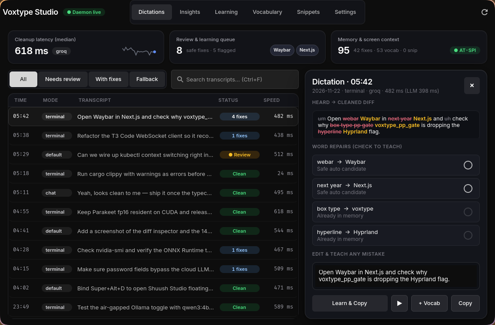

Piping a speech-to-text transcript straight into an LLM feels magical for the first five minutes. Then it rewrites your tone, drops a CLI flag, or answers a question you were dictating into Slack.

Across **333 real coding and chat dictations (19,498 words)**, we found that raw LLM cleanup fails in two predictable ways: **over-helpful paraphrasing** and **dictionary poisoning**. Solving both took less than 500 lines of deterministic Python in front of and behind the model.

## 1. The clean-pass fast path (24 ms)

Most short, clean dictations do not need an LLM round trip at all. Before making any network or Ollama call, `voxtype_pp_gate.py` checks whether the raw Parakeet transcript contains filler words, self-correction markers, or ungrounded mishearings.

When the transcript is already clean, Shuush applies exact vocabulary casing (`voxtype_pp_gate.py finish`) and emits the text in **24 ms** instead of waiting 500 ms for a model.

## 2. Grounding repairs in 5 context sources

Speech recognizers do not know the identifiers in your editor. Parakeet hears `webar` for `Waybar`, `next year` for `Next.js`, and `box type pp gate` for `voxtype_pp_gate`.

At the moment your hotkey goes down, Shuush snapshots five bounded, secret-redacted context sources:

1. Active window class and title (Hyprland, Niri, or Sway).
2. Visible `<screen>` text and focused `<draft>` via AT-SPI (capped at 250 ms).
3. Highlighted `<selection>` in the focused window.
4. Fresh `<clipboard>` text — **only** if its SHA-256 hash changed within the last 15 seconds.
5. Current `<now>` date anchor.

Every unique identifier across those five sources is passed into the span gate as `PP_SCREEN_TERMS`. If AT-SPI reports a password or sign-in field, the pipeline bypasses the LLM entirely, types locally, and skips both history and clipboard.

## 3. Aligning every word back to what you actually said

When the cleanup model replies (whether local Ollama `qwen3:4b` or Groq via our warm TLS keep-alive proxy), `voxtype_pp_gate.py constrain` aligns the cleaned output against the raw recognizer tokens with `SequenceMatcher`.

- Filler deletions (`um`, `uh`, false starts) are allowed.
- Punctuation and capitalization fixes are allowed.
- Word replacements are allowed **only** if the replacement is phonetically close to what was heard *and* grounded in `vocabulary.txt`, `corrections.tsv`, or `PP_SCREEN_TERMS`.
- Unjustified paraphrases are reverted to your original words automatically.

## 4. Self-learning without poisoning ordinary English

The nastiest bug in early self-learning prototypes was learning context guesses like `hosts -> hooks` or `things -> tasks`. Once stored as a hint, every future dictation containing "hosts" got nudged toward "hooks".

`voxtype_learn.py` prevents this with four hard rules:

1. **Ordinary English blocklist**: single-word heard tokens found in system dictionaries (`/usr/share/dict/cracklib-small`, `/usr/share/dict/words`, plus a built-in fallback wordlist) are never auto-learned.
2. **Leading/trailing stopword guard**: multi-word phrases starting or ending with function words (`the`, `like`, `an`) are rejected.
3. **Phonetic and spoken-digit folding**: `t three -> T3` and `cube ctl -> kubectl` still match automatically when grounded in your screen or vocabulary.
4. **Casing-preserving swap logs + permanent reject list**: every suggestion in Shuush Studio can be taught (auto-syncing to `voxtype`'s Layer-1 `config.toml [text] replacements`) or dismissed permanently with `Undo`.

The result is **98.8% cleanup reliability** at **516 ms P50 latency** — and when a provider times out, deterministic local cleanup still delivers your text with zero dropped words.
