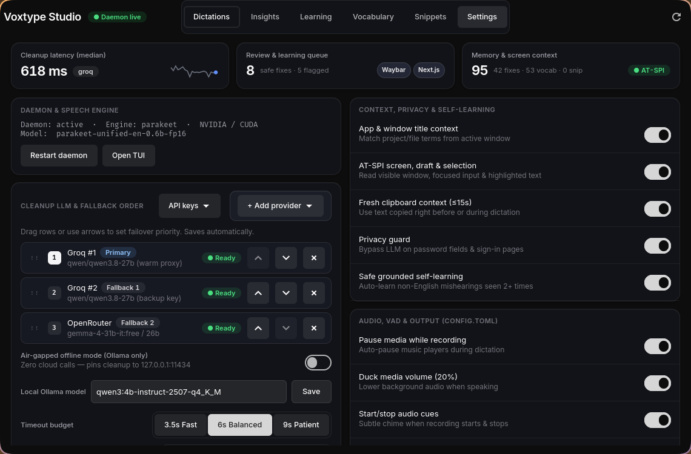

Omarchy recently made Superwhisper its default dictation experience. Superwhisper is well-built, but its free cloud tier caps out at **10,000 words per 30 days** — a limit most daily coding users cross in under two weeks (we crossed **19,498 words** in normal terminal and chat usage).

If you run **Arch Linux, Omarchy, Hyprland, Sway, or Niri**, you can run unlimited local GPU dictation with 5-source screen context, air-gapped Ollama cleanup, and a native GTK4 Studio in under two minutes — without replacing your system `voxtype-bin` package.

## Clean separation of concerns

Shuush does not fork or bundle its own speech daemon. Each layer owns one job:

- **`voxtype`** (MIT, by Peter Jackson): PipeWire audio capture, CUDA/Vulkan/CPU inference (Parakeet, Whisper, Cohere GGUF), and Wayland typing.
- **`shuush`**: 5-source AT-SPI/selection/clipboard context, anti-paraphrase span gate, phonetic self-learning, `KitsuneHud` liquid-glass Quickshell pill, and GTK4 Studio.
- **Your compositor (`Hyprland`, `kuwai`, `Sway`, `Niri`)**: Hotkeys and window rules only — zero duplicated scripts.

## Step 1: Check your system

Run the standalone pre-flight doctor to verify Wayland, GPU acceleration, `voxtype`, GTK4, and AT-SPI:

```bash
curl -fsSL https://shuush.kitsunekode.in/doctor.sh | bash
```

If `voxtype` is not installed yet on Arch or Omarchy:

```bash
yay -S voxtype-bin wtype wl-clipboard jq python-gobject libadwaita gtk4 at-spi2-core
voxtype setup
```

`voxtype` works across **NVIDIA CUDA** (Parakeet fp16 uses ~2.3 GB VRAM on a 6 GB RTX 4050), **AMD ROCm/Vulkan** and **Intel Vulkan** (Whisper `large-v3-turbo` or Cohere Transcribe GGUF), and **CPU-only laptops** (AVX2 int8).

## Step 2: Install Shuush in one line

```bash
curl -fsSL https://shuush.kitsunekode.in/install.sh | bash
```

This installs `~/.local/bin/shuush`, `~/.local/bin/shuush-studio`, `~/.local/share/shuush/libexec/*`, the `KitsuneHud` Quickshell pill, and systemd user services — and wires `[output.post_process]` and `[profiles.terminal/chat/command]` into `~/.config/voxtype/config.toml` after saving a timestamped backup.

## Step 3: Enable services and pick Offline or Failover mode

```bash
systemctl --user daemon-reload
systemctl --user enable --now voxtype.service shuush-llm-proxy.service shuush-live-osd.service
gsettings set org.gnome.desktop.interface toolkit-accessibility true

shuush doctor
shuush studio
```

Inside **Shuush Studio → Settings (`Alt+6`)**:

- Flip **Air-gapped offline mode (Ollama only)** for 100% local zero-network cleanup (`qwen3:4b`), or
- Click **API keys** to add a Groq, OpenRouter, or Cerebras key (stored locally in `~/.config/voxtype/secrets.env` with `chmod 600`) for **~500 ms** cloud failover.



## First-party `kuwai` rice users

If you run the `kuwai` Hyprland rice, `hypr/kuwai/voxtype.lua` automatically discovers `~/.local/share/shuush/libexec/`, routes notifications through `kuwai-notify`, and lets `kuwai`'s island host the pill via `VOXTYPE_OSD_HOST` with zero extra config.
