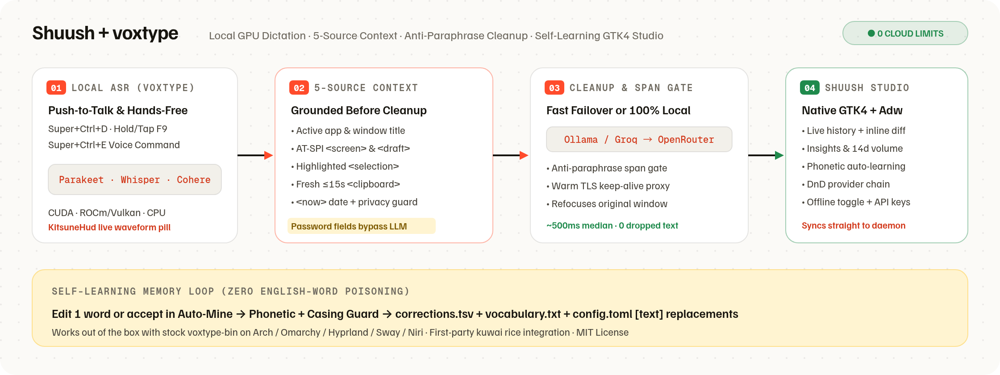
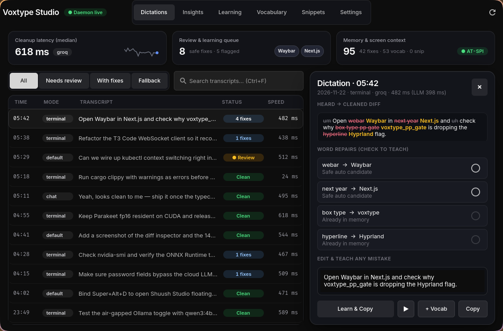
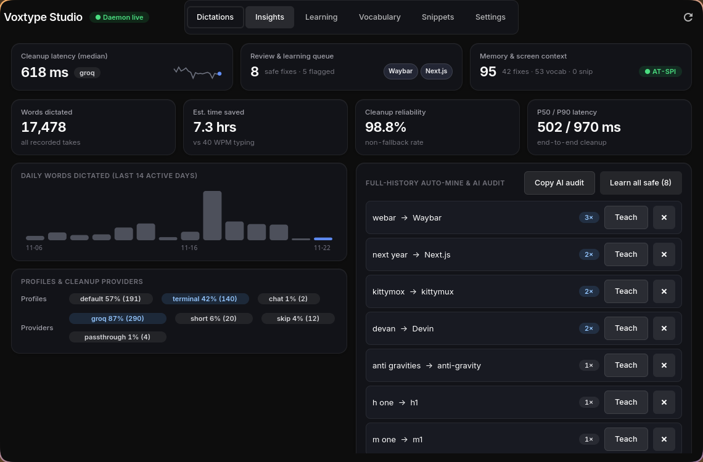

> **TL;DR · Direct Answer & Verified Benchmarks**
> - **What Shuush is:** A free, MIT-licensed desktop intelligence layer & native GTK4 Studio built on top of stock [`voxtype`](https://github.com/peteonrails/voxtype) for Linux/Wayland (Hyprland, Omarchy, Sway, Niri) with first-party `kuwai` rice integration.
> - **Why not cloud dictation?** Wispr Flow costs $15/month and doesn't ship on Linux; Omarchy's default Superwhisper cloud tier caps free usage at 10,000 words/month. We already dictated **19,498 words across 333 real takes** (~8.1 hours saved).
> - **Measured performance (Intel i5-13450HX · RTX 4050 Laptop 6 GB VRAM · 23 GiB RAM):** Parakeet fp16 uses **~2.3 GB VRAM** locally; end-to-end cleanup runs at **516 ms P50 / 1,060 ms P90** with **98.8% reliability** (or **24 ms** when already clean).

## 1. The Gap on Linux Voice Dictation

Voice dictation became genuinely useful for software engineers once tools like **Wispr Flow** and **Superwhisper** paired speech recognition with *active window context* and fast LLM cleanup.

On Linux, however, developers hit a frustrating split: accept closed-source apps with monthly word caps (like Superwhisper's 10,000 free words/30 days on Omarchy), or wire bare Whisper scripts that spell `Waybar` as "webar", `Next.js` as "next year", and `voxtype_pp_gate` as "box type pp gate".

Instead of forking or reinventing the Rust audio/inference daemon, we built **Shuush** cleanly on top of Peter Jackson's MIT-licensed [`voxtype`](https://github.com/peteonrails/voxtype). Proper separation of concerns means:

- **`voxtype`** owns low-level PipeWire capture, CUDA/Vulkan/CPU ASR inference (Parakeet, Whisper, Cohere GGUF), and Wayland typing.
- **`shuush`** owns the 5-source context pipeline, anti-paraphrase span gate, phonetic self-learning engine, `KitsuneHud` Quickshell pill, and native GTK4 Studio.
- **`kuwai`** (or your own Hyprland/Sway/Niri config) only keeps compositor bindings, window rules, and optional island hosting — zero duplicated dictation scripts.



## 2. Five Grounded Context Sources — Locally and Unlimited

Superwhisper's signature mode works because the cleanup model sees what you're looking at. Shuush captures **5 bounded, secret-redacted context sources** on Wayland the instant you press your hotkey:

1. **Active application & window title** (Hyprland, Niri, Sway) to pick the right profile (`terminal`, `chat`, or `default`) and refocus the original window if you switch away while polishing.
2. **AT-SPI visible `<screen>` & focused `<draft>`** (`voxtype_screen_ctx.py`, hard-capped at 250ms) so visible identifiers ground symbol spelling — and real password fields trigger an instant privacy bypass.
3. **Highlighted `<selection>`** captured in the background on normal dictation too, so saying *"fix this error in that hook"* resolves exact identifiers.
4. **Fresh `<clipboard>` (≤15-second window)** tracked by SHA-256 hash + timestamp, so a stack trace copied 5 seconds ago improves accuracy while a 2-hour-old clipboard never pollutes a prompt.
5. **Current date anchor (`<now>`)** so relative date references stay grounded.

## 3. Why Raw LLM Cleanup Fails — and the Anti-Paraphrase Span Gate

Anyone who pipes raw Whisper output into an LLM hits the same wall: the model rewrites your phrasing, drops flags, or answers dictated questions instead of transcribing them.

Shuush's deterministic `voxtype_pp_gate.py` aligns every cleaned reply back against the raw ASR transcript. Word changes are accepted only if they are filler removals, punctuation/casing fixes, or phonetically close to a term grounded in your `vocabulary.txt`, `corrections.tsv`, or live 5-source screen context. When text is already clean, Shuush skips the LLM entirely in **24 ms**.



## 4. Non-Poisoning Phonetic Self-Learning

Naive auto-learning stores catastrophic rules like `hosts → hooks` or `things → tasks` the first time an LLM guesses from context. Shuush enforces four strict guards in `voxtype_learn.py`:

- **Cross-distro English blocklist**: probes system dictionaries across Arch, Debian, Ubuntu, and Fedora plus a built-in fallback wordlist.
- **Phonetic & spoken-digit folding**: catches ASR splits like `t three → T3` and `cube ctl → kubectl` automatically when grounded in your screen or vocabulary.
- **Casing-preserving swap logging**: preserves `Next.js`, `Waybar`, and `T3` casing in history swaps.
- **Permanent Dismiss/Reject blocklist with Undo** + automatic sync into `voxtype`'s Layer-1 `config.toml [text] replacements`.



## 5. Real-World Hardware Benchmarks (333 Takes)

Measured on an **Intel i5-13450HX · NVIDIA RTX 4050 Laptop (6 GB VRAM) · 23 GiB RAM · Arch + Hyprland**:

| Metric | Measured Value | Notes |
|---|---|---|
| Speech-to-text VRAM | **~2.3 GB** | Parakeet Unified EN 0.6B fp16 on CUDA |
| Dictation volume | **19,498 words** | 333 takes (~8.1 hours saved vs 40 WPM typing) |
| Cleanup latency | **516 ms P50 · 1,060 ms P90** | Warm TLS keep-alive proxy + Groq failover |
| Clean-pass fast path | **24 ms** | Deterministic bypass when already clean |
| Reliability | **98.8%** | 1.2% cleanly fall back locally — zero dropped text |

## 6. Install in 60 Seconds

Works out of the box on stock `voxtype-bin` across NVIDIA CUDA, AMD ROCm/Vulkan, Intel Vulkan, and CPU:

```bash
yay -S voxtype-bin wtype wl-clipboard jq python-gobject libadwaita gtk4 at-spi2-core
voxtype setup
git clone https://github.com/KitsuneKode/shuush.git && cd shuush
./install.sh --wire-config
shuush doctor && shuush studio
```

Open **Settings (`Alt+6`)** to flip **Air-gapped offline mode (Ollama only)** or enter cloud API keys (`chmod 600` in `~/.config/voxtype/secrets.env`).
